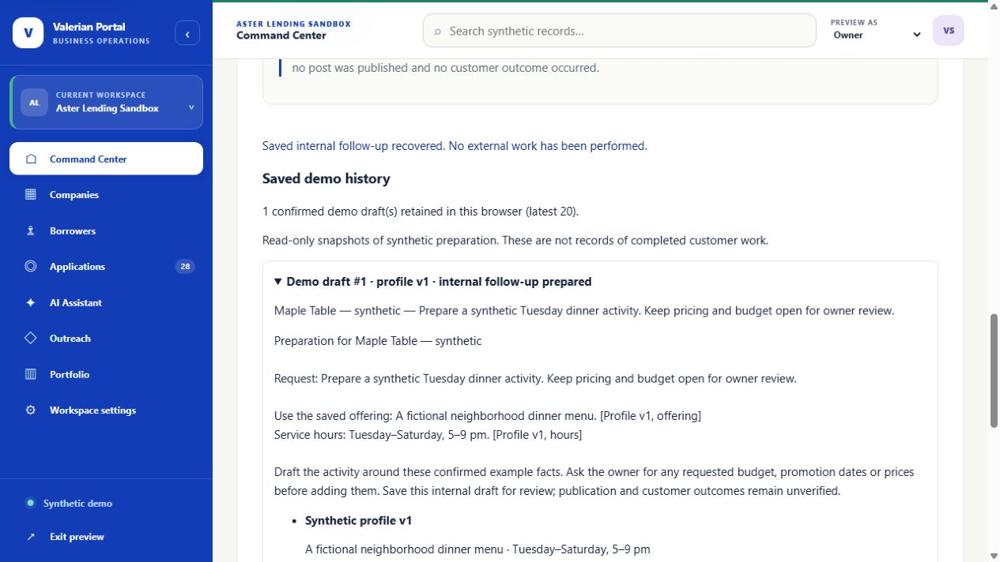

# Recoverable synthetic workflow - October 29, 2026

## Problem and changes

The prior branch completed the happy path, but an edited profile or request could remain unsaved while an old confirmation was still usable. Restored confirmation was not bound to the exact saved source content. History shared source objects with the active draft and the interface only showed a count.

The existing no-backend architecture is retained. Original code is now separated into `demo-template.mjs` (synthetic examples), `demo-state.mjs` (pure domain transitions and snapshot validation), `demo-storage.mjs` (bounded versioned persistence) and `business-demo.mjs` (DOM wiring and recovery). Existing public state-function exports remain available from `business-demo.mjs`. There is no new dependency, model, framework or connection to private services.

Current confirmation identifies an immutable-by-copy history snapshot of profile, request, draft and sources. It is invalidated by changed saved input. Repeated actions on an unchanged reviewed version do not create additional records. Restoration checks the snapshot and the continuation event separately. Historical text is rendered with `textContent`, and unknown fields are discarded.

Unsaved text is stored separately from approved content, including temporarily blank fields. Any pending edit blocks confirmation/continuation. Save the applicable field or use Discard unsaved changes. Saving changed profile facts starts a new preparation; confirmed history remains available. A conflicting tab requires Load latest saved demo, explicitly discarding that tab's conflicting input. Quota or access errors leave a usable tab with an explicit persistence warning. Failed reset does not falsely promise removal from browser storage.

## Reproduction

```sh
pnpm install --frozen-lockfile
pnpm test
pnpm test:browser
python -m http.server 8771 --bind 127.0.0.1
```

Open `http://127.0.0.1:8771/`. No keys or environment variables are needed. Keep the same origin to reuse saved data. Test examples must be invented; this is not a personal-data vault.

## Evidence and limits

The unchanged baseline was `720a815f7d21df80074a75c7c0259d7b0f99c52b` with three existing tests passing. Before product edits, 16 additional state cases were frozen: 2 passed and 14 failed. The same test source then passed 16/16. All 31 state/storage tests pass, including the three original tests. The fixtures were authored by the implementing assistant and are not independently blind.

Actual Edge automation covers empty-state registration, source inspection, rejection without explicit review, editing, confirmation, continuation, reload, recovery of three unsaved input types, keyboard history inspection and reset at 1,280 and 390 CSS pixels. Separate same-origin tabs exercise conflict/reload and reset propagation. Injected quota/removal errors exercise honest tab-only and reset-failure behavior without changing real browser privacy settings. External requests and page script errors are counted. The first extended browser attempt failed at 200% CSS zoom; the log is retained. Content-width responsive rules fix that overflow. CSS zoom is a reflow check, not a physical-phone or OS/browser-zoom acceptance claim.

Interactive in-app browser inspection additionally completed registration, preparation, missing-review rejection, confirmation, refresh recovery of a pending profile edit, explicit discard, continuation, mobile draft revision, keyboard confirmation, history expansion and reset after reload. The synthetic assistant's conversation reset was also inspected. One rapidly batched mobile navigation action did not activate; keyboard navigation and a fresh observed pointer action both succeeded. Observed dimensions were 1,280 × 720 and 390 × 844; document widths were 1,265 and 375. Independent human participation was not performed.

See the [frozen baseline](../evaluations/state-before-2026-10-29.json) and [final receipt](../evaluations/state-verification-2026-10-29.json), including source and retained-log hashes, for the exact evidence. Raw local logs contain machine paths and remain ignored. The final browser suite passed after the last state changes.



[Mobile history inspection](images/recovery-mobile-2026-10-29.jpg)

This improves predictable interaction and recovery. It does not establish an AI-quality improvement: there were zero external model requests. It does not establish real publication, customer adoption, business completion or revenue.

Remaining limits: browser storage can be edited or cleared by its owner; snapshot consistency is not authentication or a security boundary. Conflict detection is optimistic, not a multi-user atomic database. The latest 20 records are retained, not an unlimited archive. Different origins/devices do not synchronize. Real browser zoom, physical devices, assistive-technology testing and independent first-time users remain separate acceptance work.

## Migration, deployment and rollback

New saves use `valerianPortalSandbox.business.v2`. When absent, validated v1 content is recovered; old confirmations require a new review, legacy history is labelled, and the original v1 key remains unchanged. Reset demo clears v1 and v2; a storage exception is reported. No server/database migration occurs.

The branch is a draft and has not been deployed. Publication still requires approval of a concrete static commit. Roll back by serving the previous approved static commit. The v1 copy contains only data saved before migration; it does not include new v2 edits. Preserve needed synthetic text before rollback. Forward recovery remains available by restoring the v2 static build; do not overwrite or transform browser keys manually to fabricate review.
